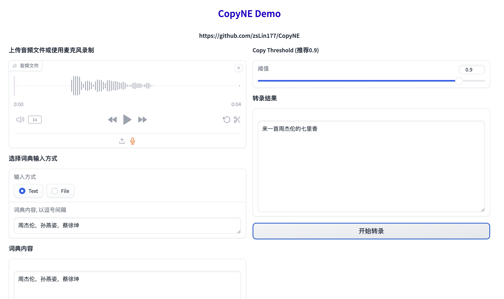

# CopyNE: Better Contextual ASR by Copying Named Entities
This is the fork for CopyNE, a novel approach for contextual ASR. The paper has been accepted in ACL 2024. It can be found at [here](https://arxiv.org/abs/2305.12839).

## Installation
In a Kaggle notebook cell:
```bash
# Clone repository and enter directory
!git clone https://github.com/beaver-felix/CopyNE.git
%cd CopyNE

# Install requirements
!pip install -r requirements.txt
```

## Data Preparation
```bash
%cd /kaggle/working/CopyNE/data_to_upload
# Download and unzip the AISHELL dataset
!wget -c https://us.openslr.org/resources/33/data_aishell.tgz
!tar -zxvf data_aishell.tgz

# Update wav path in json files
%cd /kaggle/working/CopyNE
!python scripts/change_wav_path.py data_to_upload/aishell_dataset/train_addne.json data_to_upload
!python scripts/change_wav_path.py data_to_upload/aishell_dataset/dev_addne.json data_to_upload
!python scripts/change_wav_path.py data_to_upload/aishell_dataset/test_addne.json data_to_upload
!python scripts/change_wav_path.py data_to_upload/aishell_dataset/dev-ne.json data_to_upload
!python scripts/change_wav_path.py data_to_upload/aishell_dataset/test-ne.json data_to_upload
```

## Web Demo
Web demo for CopyNE using Gradio. Starts public Gradio live tunnel via `--share` for Kaggle notebooks:
```bash
!CUDA_VISIBLE_DEVICES=0 torchrun --nnodes=1 --nproc_per_node=1 api.py \
    --char_dict data_to_upload/multi_char.vocab \
    --add_context \
    --add_copy_loss \
    --config conf/copyne.yaml \
    --path exp/copyne_pretrained \
    --use_avg \
    --share
```
Example of the web demo:


## Training
Targeted for Kaggle GPUs (e.g. 2x T4 GPUs):
```bash
!torchrun --nnodes=1 --nproc_per_node=2 --master_port=29501 train.py \
    --train data_to_upload/aishell_dataset/train_addne.json \
    --dev data_to_upload/aishell_dataset/dev_addne.json \
    --test data_to_upload/aishell_dataset/test_addne.json \
    --add_context \
    --pad_context 2 \
    --att_type simpleatt \
    --add_copy_loss \
    --train_ne_dict data_to_upload/aishell_vocab/train_ne.vocab \
    --dev_ne_dict data_to_upload/aishell_vocab/dev_ne.vocab \
    --path exp/copyne_aishell_beta1/ \
    --batch_size 16 \
    --seed 777 \
    --config conf/copyne.yaml \
    --char_dict data_to_upload/aishell_vocab/char.vocab \
    --cmvn data_to_upload/aishell1_global_cmvn_mel80 \
    --num_workers 2
```
> Note: For single GPU (1x T4 / P100), set `--nproc_per_node=1`.

## Predict and Evaluation
```bash
# Predict on test-ne set
!torchrun --nnodes=1 --nproc_per_node=1 evaluate.py \
    --char_dict data_to_upload/aishell_vocab/char.vocab \
    --add_context \
    --att_type simpleatt \
    --add_copy_loss \
    --config conf/copyne.yaml \
    --input data_to_upload/aishell_dataset/test-ne.json \
    --test_ne_dict data_to_upload/aishell_vocab/test_ne.vocab \
    --path exp/copyne_aishell_beta1/ \
    --res test-ne.pred \
    --decode_mode copy_attention \
    --copy_threshold 0.9 \
    --batch_size 16 \
    --beam_size 10

# Compute CER and NE-CER
!bash compute-necer.sh data_to_upload/aishell_dataset/test-ne.text test-ne.pred.asr
```


## Acknowledge
1. I borrowed some code from [copyne](https://github.com/zslin177/copyne) for CopyNE's implementation.
2. I borrowed some code from [icefall](https://github.com/k2-fsa/icefall) for Zipformer's implementation.
```

